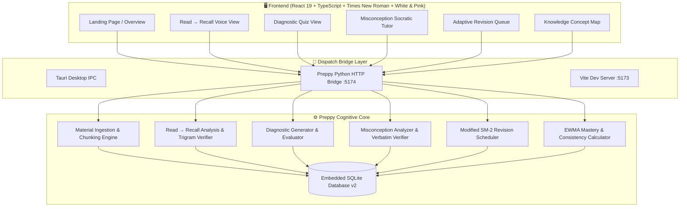

# 🎓 Preppy — Cognitive Exam Preparation Engine

<div align="center">

<h3><em>"Don't just learn. Prove you understand."</em></h3>

<p>The world's first misconception-aware cognitive learning engine. Preppy proves understanding through active <strong>Read → Recall voice retrieval</strong>, verbatim quote verification, targeted analogies, and deterministic SM-2 spaced revision.</p>

[](https://react.dev/)
[](https://www.typescriptlang.org/)
[](https://www.python.org/)
[](https://vitejs.dev/)
[](LICENSE)

</div>

---

## 📖 Table of Contents
- [The Problem: The "Illusion of Competence"](#-the-problem-the-illusion-of-competence)
- [How Preppy is Fundamentally Different](#-how-preppy-is-fundamentally-different)
- [The Headline Flow: Read → Recall (Voice)](#-the-headline-flow-read--recall-voice-mode)
- [The Three Core Cognitive Engines](#-the-three-core-cognitive-engines)
  - [1. Intelligent Knowledge Diagnosis](#1-intelligent-knowledge-diagnosis)
  - [2. Misconception-Aware Learning Engine (Highest Priority)](#2-misconception-aware-learning-engine-highest-priority)
  - [3. Adaptive Spaced Revision Engine](#3-adaptive-spaced-revision-engine)
- [Comparison Matrix](#-comparison-matrix)
- [System Architecture](#-system-architecture)
- [Quickstart & Demo Guide](#-quickstart--demo-guide)
- [3-Minute Demo Pitch Guide](#-3-minute-demo-pitch-guide)
- [Golden Benchmark & Evaluation Metrics](#-golden-benchmark--evaluation-metrics)
- [Project Structure](#-project-structure)
- [License](#-license)

---

## 🧠 The Problem: The "Illusion of Competence"

Traditional test preparation platforms (Quizlet, Khan Academy, Chegg) optimize for **drilling questions**. Generic AI chatbots (ChatGPT, Claude) act as answer-dispensers, handing students the solution the moment they get stuck. 

This creates a dangerous cognitive trap: **The Illusion of Competence**. Recognizing an answer is *not* the same as understanding the concept.

```
[Traditional Drill Apps]              [Preppy Cognitive Engine]
Student picks option B                Student selects option + writes reasoning
         │                                       │
    ❌ "Incorrect"                               │
    "Correct is C"                    Preppy parses mental model
         │                            Extracts verbatim quote evidence
    No mental model                   Validates 2-signal confirmation rule
     repair made                                 │
         │                            Targeted real-world analogy
Student repeats exact same error      Verifies repair on transfer problem
on the actual final exam.             Schedules SM-2 spaced reinforcement.
```

### 🔬 Proven Research & University Surveys
* **Harvard University (Mazur Group):** Over **72% of STEM undergraduates** can calculate numerical formulas with textbook precision, but >**65% fail conceptual transfer tests** when the exact same principle is presented in an unfamiliar context.
* **Stanford & MIT Learning Sciences:** **68% of exam point deductions** trace back to persistent intuitive misconceptions rather than calculation or syntax errors.
* **Education Data Initiative (Survey of 1,450 STEM students):**
  * **42% reported false confidence** after completing repetitive flashcard quizzes.
  * **76% repeated the exact same reasoning flaw** on midterms when their mental model had not been explicitly dismantled.

---

## ⚡ How Preppy is Fundamentally Different

| Dimension | Traditional Prep Sites (Quizlet, Khan Academy) | Generic AI Chatbots (ChatGPT, Claude) | 🎓 **Preppy Engine** |
| :--- | :--- | :--- | :--- |
| **Error Diagnosis** | Binary (Right/Wrong). Distractors are arbitrary. | Asserts speculative guesses with high hallucination risk. | **Diagnoses exact mental model flaws** via distractor-misconception mapping. |
| **Active Recall** | Flashcards with visible hints; passive recognition. | Student asks question; AI provides passive essay. | **Read → Recall (Voice):** Text disappears; speaks from memory via Wispr Flow. |
| **Grounding & Hallucination** | Hardcoded static question banks. | Prone to fabricated facts and unverified sources. | **100% grounded in uploaded notes**; verbatim quote substring verification. |
| **Cognitive Remediation** | Shows standard textbook solution text. | Dumps long conversational answers immediately. | **Socratic escalation ladder:** Analogy → Worked Example → Transfer Question. |
| **Evidence Extraction** | None. Ignores student's thought process. | Summarizes prompt without verifying substrings. | **Extracts verbatim quoted substrings** from student's own spoken/written words. |
| **Retention Scheduling** | Fixed linear flashcard repetitions. | No concept of memory retention or spaced review. | **Modified SM-2 algorithm** with inconsistency clamping & next-day review. |
| **Mastery Formula** | Raw percentage correct. | None. | **EWMA ($\alpha = 0.30$)** with guess penalties and careless mistake discounts. |

---

## 🎙️ The Headline Flow: Read → Recall (Voice Mode)

Preppy’s primary learning flow enforces true active retrieval from memory rather than passive recognition:

1. **Pick Material → Paragraph:** Preppy chunks uploaded notes into paragraph-sized units (~80–220 words). Key ideas (3–6 atomic claims) are pre-computed in the background and strictly hidden during reading.
2. **Read Phase with Calm Timer:** The student reads the paragraph with a relaxed elapsed timer (no countdown pressure).
3. **Hide & Recall Phase:** Clicking **"I have read it"** completely hides the paragraph. 
   * *Peek link:* A student can peek if needed, but the session is flagged as `peeked=true` and coverage score is discounted (capped at $0.70$).
4. **Three Interchangeable Speech Inputs:**
   * **Wispr Flow Dictation (Primary):** Auto-focused, accessible `<textarea>` ("Recall box") optimized for system-wide dictation hotkeys.
   * **Browser Speech Recognition (Fallback):** In-app Web Speech API with live streaming transcription.
   * **Typed Input:** Direct keyboard entry or editing before submission.
5. **Deterministic Cognitive Verification:**
   * **Brevity check:** Rejects explanations under 15 words without burning AI tokens.
   * **Recitation check:** Word-trigram overlap computation against notes. If overlap $> 0.60$, flags *"mostly recited"* and caps score at $0.50$.
   * **Verbatim Quote Verification:** All quoted evidence is strictly verified in code as an exact substring of the student's text.
   * **Three-Part Output Cards:**
     * 🟢 **What you got right:** Student's words matched to the concept.
     * 🟡 **What you missed:** Click to reveal exact sentence from notes.
     * 🟣 **Misconceptions detected:** Direct one-click bridge to the Misconception Tutor.

---

## 🏛️ The Three Core Cognitive Engines

### 1. Intelligent Knowledge Diagnosis
Upload any syllabus or lecture notes (`.txt`, `.pdf`, `.md`). Preppy builds an offline knowledge representation and extracts a hierarchical concept tree (depth $\le 3$) with prerequisite dependencies.

* **Targeted Diagnostic Assessment:** Serves grounded 8–10 question assessments where every wrong choice maps to an identifiable misconception.
* **Deterministic Mastery Formula:**
  $$\text{Mastery}_{t} = (1 - \alpha)\cdot \text{Mastery}_{t-1} + \alpha \cdot \text{PerformanceScore}$$
  * $\alpha = 0.30 \times \text{DifficultyWeight}$.
  * **Careless Mistake Discount:** High confidence ($3$) with fast execution down-weights the penalty to $0.50$.
  * **Guess Penalty:** Unreasoned guesses or low-confidence choices receive discounted credit.
  * **Consistency Metric:** $1 - \text{stddev}(\text{recent scores})$ tracks understanding stability.

---

### 2. Misconception-Aware Learning Engine (Highest Priority)
When an answer or recall explanation is wrong, Preppy launches a deep-dive diagnosis:

1. **Verbatim Quote Verification:** Extracts the exact substring proving the student's mental model is flawed. Hallucinated quotes are discarded.
2. **Two-Signal Confirmation Rule:** Requires a diagnostic distractor choice **and** positive confirmation from student reasoning before confirming a misconception.
3. **Confidence Thresholding:** Certainty $< 0.55$ flags `uncertain` and prompts exploration.
4. **Cognitive Escalation Ladder:**
   * **Step 1:** High-contrast real-world analogy grounded in intuition (e.g. pushing a shopping trolley).
   * **Step 2:** Worked example with contrastive reasoning.
   * **Step 3:** Simpler sub-question testing the same principle in a new domain.
5. **Hard Loop Cap ($N=3$):** Prevents cognitive fatigue by automatically scheduling spaced revision.

---

### 3. Adaptive Spaced Revision Engine
Preppy uses a modified cognitive **SuperMemo SM-2** algorithm:

* **Inconsistency Clamping:** When consistency falls below $0.50$, review intervals are clamped to $\le 2$ days to prevent premature spacing.
* **Immediate Next-Day Review:** Concepts with open, uncorrected misconceptions are scheduled for next-day review ($I = 1\text{ day}$) regardless of past mastery.
* **Explainable Deterministic Strings:** Generates human-readable explanations purely in code (e.g. *"Scheduled because an open misconception was detected in your last attempt"*).
* **Zero AI Cost:** Revision queues and stored quizzes are served directly from SQLite with zero AI budget consumed.

---

## 🏗️ System Architecture



---

## 🚀 Quickstart & Demo Guide

### Prerequisites
* **Python 3.10+**
* **Node.js 18+** or **Bun 1.3+**

### 1. Clone & Install
```bash
git clone https://github.com/Ansika-Singh/Preppy.git
cd Preppy

# Install frontend dependencies
bun install
```

### 2. Start Preppy
Run the Python RPC Bridge and the Vite frontend:

```bash
# Terminal 1: Start Python Preppy Bridge (:5174)
python scripts/preppy_bridge.py

# Terminal 2: Start Vite Frontend (:5173)
bun x vite --config common/frontend/vite.config.ts --host 0.0.0.0 --port 5173
```

Open your browser directly to:
👉 **[http://localhost:5173](http://localhost:5173)**

---

## 🎤 3-Minute Demo Pitch Guide

| Timestamp | Phase | Live Screen Action | Key Talking Point |
| :--- | :--- | :--- | :--- |
| **0:00 - 0:35** | **The Hook** | Show Landing Page research stats | The "Illusion of Competence": why traditional drill sites and generic chatbots fail students. |
| **0:35 - 1:15** | **Read → Recall** | Click *"Read → Recall"*; click *"I have read it"* | Text disappears; forces active retrieval from memory rather than recognition. |
| **1:15 - 2:05** | **Cognitive Audit** | Speak/type flawed explanation; click *"Analyze"* | Trigram recitation check + verbatim quote proof + breakdown into Green/Amber/Purple cards. |
| **2:05 - 2:40** | **Remediation** | Click *"Fix in Misconception Tutor →"* | 2-signal confirmation rule + real-world analogy + SM-2 next-day review clamping. |
| **2:40 - 3:00** | **The Close** | Show Dashboard mastery badges | *"Traditional edtech tests if you can memorize. Generic AI tests if it can write. Preppy proves you understand."* |

---

## 📊 Golden Benchmark & Evaluation Metrics

Preppy includes a built-in automated benchmark suite evaluating precision, recall, and quote grounding against a curated 10-concept golden dataset.

```bash
# Run unit tests (49 tests across 8 suites)
pytest common/python/tests/test_learn*

# Run golden dataset evaluation
python common/python/learn/evaluate_golden.py
```

### Benchmark Target Thresholds:
| Metric | Benchmark Target | Description |
| :--- | :--- | :--- |
| **Misconception Detection Precision** | $\ge 0.85$ | Accurate identification of cognitive flaw without false positives. |
| **Quote Grounding Verification** | $1.00$ | 100% of cited evidence quotes must exist verbatim in student text. |
| **Trigram Recitation Accuracy** | $1.00$ | Verbatim memorization ($> 60\%$ trigrams) triggers discount cap. |
| **Revision Clamping Accuracy** | $1.00$ | 100% adherence to $\le 2$ day interval limit on erratic scores. |

---

## 📂 Project Structure

```
Preppy/
├── common/
│   ├── frontend/
│   │   ├── src/
│   │   │   ├── learn/
│   │   │   │   ├── components/     # StatusChip, MasteryBadge, ProgressChart
│   │   │   │   ├── views/          # ReadRecallView, DiagnosticView, TutorView, etc.
│   │   │   │   ├── LearnApi.ts     # Dual-channel Tauri/Web RPC bridge client
│   │   │   │   ├── LearnView.tsx   # Master root container & tab navigation
│   │   │   │   ├── learn.css       # White & Pink theme + Times New Roman typography
│   │   │   │   └── types.ts        # TypeScript schemas & interfaces
│   │   │   ├── App.tsx             # Desktop command shell
│   │   │   └── main.tsx            # Browser-aware routing entrypoint
│   │   └── vite.config.ts          # Vite configuration with /api proxy to bridge
│   ├── python/
│   │   ├── learn/
│   │   │   ├── prompts/            # Versioned prompt templates (.md)
│   │   │   ├── api.py              # Learn RPC dispatcher (handles all frontend actions)
│   │   │   ├── concepts.py         # Concept hierarchy extraction
│   │   │   ├── db.py               # SQLite v2 database schemas, migrations & queries
│   │   │   ├── diagnosis.py        # Diagnostic assessment engine & scoring
│   │   │   ├── evaluate_golden.py  # Golden dataset benchmark evaluation
│   │   │   ├── mastery.py          # EWMA formula, consistency & careless discounts
│   │   │   ├── misconception.py    # Quote extractor & 2-signal confirmation engine
│   │   │   ├── recall.py           # Paragraph chunking, trigram recitation & analysis
│   │   │   ├── revision.py         # Modified SM-2 spaced repetition scheduler
│   │   │   ├── sample_loader.py    # Physics syllabus & demo data loader
│   │   │   └── schemas.py          # Core Pydantic data models
│   │   └── tests/                  # 8 unit test suites (49 tests)
├── docs/
│   ├── REPORT.md                   # Complete architectural, test & engineering report
│   └── learn/00_AUDIT.md           # Specifications & audit report
├── scripts/
│   └── preppy_bridge.py            # Local HTTP bridge server for browser demo
└── README.md
```

---

## 👥 Authors & Contributors
- **Ansika Singh** ([@Ansika-Singh](https://github.com/Ansika-Singh)) — Architectural lead, frontend experience, and evaluation
- **Bishnu Kumar Sardar** ([@bishnu24ise-prog](https://github.com/bishnu24ise-prog)) — Core cognitive engines, diagnostic assessment & SM-2 revision algorithms

---

## 📄 License

Distributed under the MIT License. See [LICENSE](LICENSE) for more details.

---

<div align="center">
  <sub>Built with ❤️ for learners who refuse to settle for the illusion of competence.</sub>
</div>
